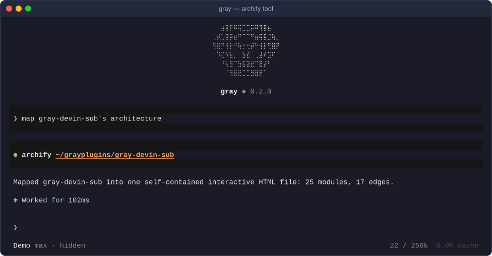
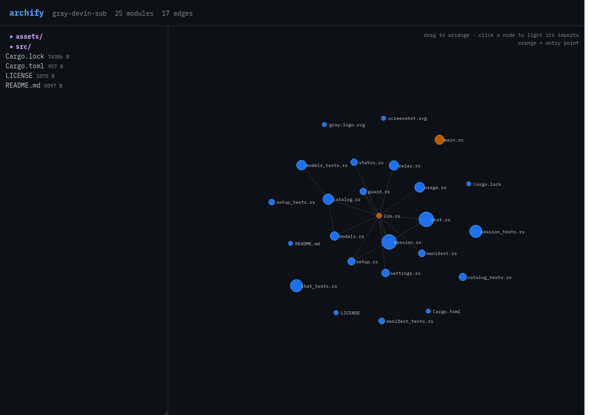
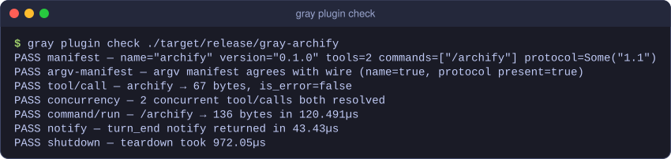

<p align="center">
  
</p>
<h1 align="center">gray-archify</h1>
<p align="center">Map a repository's architecture into one self-contained interactive HTML file.</p>
<p align="center">
  <a href="LICENSE"></a>
  <a href="https://gray.alignment.id"></a>
  <a href="https://www.rust-lang.org"></a>
  <a href="https://github.com/vstaln/gray-archify/releases"></a>
</p>

Map a repository's architecture into ONE self-contained interactive HTML
file — no external assets, opens offline. The artifact is the deliverable.

## Screenshot

An `archify` tool call inside a gray session, and the map it wrote
(rendered from the generated `archify.html`):





## Install

Not in the plugin hub yet, so install from source (needs a Rust toolchain):

```sh
cargo install --path .
gray plugin install ~/.cargo/bin/gray-archify
```

## Usage

### Tools

- **`archify {path?, depth?, out?}`** — walks the repo (≤500 files, skips
  `node_modules`/`.git`/`target`/…), reads sizes/loc, parses import and
  include lines (Rust `use`/`mod`, JS/TS `import`/`require`, Python
  `import`/`from`, Go imports, C/C++ `#include "…"`, Java/Kotlin `import`)
  into a module graph, and writes `out` (default `./archify.html`).
  Replies `wrote <path> (N modules, M edges)`. `depth` (default 2) is the
  max directory depth walked.
- **`archify_prompt {question, path?, depth?}`** — the agent-facing half:
  same walk, returned as a compact markdown outline (dirs → files with loc
  and resolved import targets) for the model to reason over when answering
  `question`.

### Slash command

`/archify` replies with a one-line summary of the two tools.

## How it works

### The HTML

- Left: expandable directory tree (`<details>`) with per-file loc/size and
  entry-point markers (`main.*`, `index.*`, `lib.rs`, …).
- Right: force-layout SVG module graph — vendored inline JS (~100 lines:
  repulsion + springs + centering ticks, node drag, click to light a
  module's imports). Entry points rendered orange.
- JSON data is inlined with `<` escaped so it can't break the script tag;
  all names HTML-escaped.

### Wire methods used

`plugin/manifest`, `tool/call`, `command/run` (`/archify` → status),
`plugin/shutdown`. No hooks, no capabilities — protocol 1.1.

<details>
<summary>Conformance</summary>

`gray plugin check` output for this build:



</details>

## License

MIT. See [LICENSE](LICENSE).

## Links

- Gray: <https://gray.alignment.id>
- Gray source: <https://github.com/vstaln/gray>

Part of the [gray](https://github.com/vstaln/gray) plugin ecosystem — the open-source AI agent harness.
